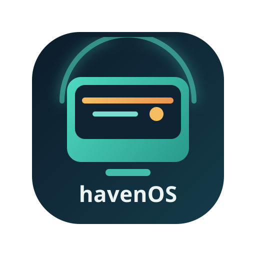
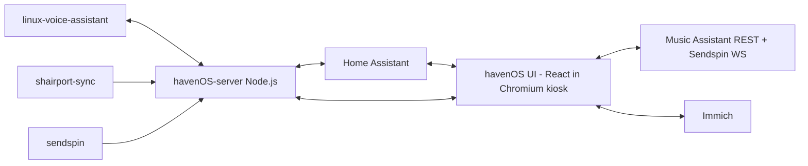

<p align="center">
  
</p>

<h1 align="center">havenOS</h1>

<p align="center">
  A fully local, touch-first smart display for Raspberry Pi.<br />
  Home Assistant powered. Offline voice ready. Zero cloud required.
</p>

<p align="center">
  <a href="SPEC.md"><strong>Read Full Spec</strong></a>
  ·
  <a href="#installation"><strong>Installation</strong></a>
  ·
  <a href="#development"><strong>Development</strong></a>
</p>

---

## What Is havenOS?

havenOS is a Nest Hub-style ambient display experience, built to run entirely on your local network. It runs in Chromium kiosk mode on a Raspberry Pi touchscreen, uses Home Assistant as a data/control bus, and renders a fully custom interface designed for glanceability and touch.

## Why This Exists

- Local-first by design: no cloud APIs, no cloud dependencies
- Touch-first UX: large hit targets and appliance-style interactions
- Ambient-first display: useful from across the room at a glance
- Custom UI, not Lovelace for primary flows
- Reliable, deterministic install target for Raspberry Pi OS Lite

## Tech Stack

| Layer     | Technology                                           |
| --------- | ---------------------------------------------------- |
| UI        | React 18, TypeScript, Tailwind CSS v4, Framer Motion |
| State     | Zustand, TanStack Query                              |
| Bundler   | Vite                                                 |
| Server    | Node.js, Express, `ws`                               |
| HA bridge | `home-assistant-js-websocket`                        |
| Photos    | Immich SDK                                           |

## System At A Glance



Runtime processes:

1. `havenos-server` — Express + WebSocket bridge (Node.js)
2. `havenos-ui` — Chromium kiosk serving the React app
3. `linux-voice-assistant` — offline wake word + STT pipeline
4. `shairport-sync` — AirPlay receiver
5. `sendspin` — local cast/audio relay

## App States

| State          | Description                                              |
| -------------- | -------------------------------------------------------- |
| `ambient`      | Full-bleed photo slideshow with clock and weather        |
| `active`       | Dashboard with module cards and quick controls           |
| `listening`    | Voice overlay with animated waveform and transcript      |
| `detail`       | Full-screen module overlay (Weather, Music, Lights, etc.)|
| `ha-dashboard` | Embedded Home Assistant Lovelace iframe                  |
| `settings`     | havenOS configuration screen                            |

## Modules

- **Weather** — current conditions, forecast, high/low from a HA `weather.*` entity
- **Music** — now-playing, playback controls via Music Assistant
- **Timers** — active HA timers with countdown and quick-set
- **Lights** — per-area brightness and scene controls
- **Climate** — thermostat control per HA climate entity
- **Cameras** — live camera feeds from HA
- **Scenes** — one-tap HA scene activations

## Hardware Target

- Raspberry Pi 4 (4GB+)
- 7"–10" HDMI touchscreen
- Target layout: 1280×800 (graceful fallback to 1024×600)
- ReSpeaker 2-Mic HAT or USB mic array
- Raspberry Pi OS Lite (64-bit)

## Installation

```bash
sudo ./install.sh
```

Options:

| Flag              | Description                                    |
| ----------------- | ---------------------------------------------- |
| `--yes`           | Non-interactive, accept all defaults           |
| `--user NAME`     | Service user name (default: `havenos`)         |
| `--skip-packages` | Skip apt package installation                  |
| `--skip-node`     | Skip Node.js installation via NodeSource       |
| `--skip-kiosk`    | Skip Chromium kiosk service installation       |

The installer is idempotent — safe to re-run. After install, edit `/opt/havenos/config.json` with your Home Assistant URL, long-lived token, and Immich details.

## Development

```bash
# Install dependencies
npm install

# Start dev server (UI + server with hot reload)
npm run dev
```

The Vite dev server runs on port `5173` and proxies `/api` and `/events` WebSocket traffic to the Node server on port `3001`.

```bash
# Production build
npm run build

# Preview production build
npm run preview
```
- ReSpeaker 2/4-mic input hardware
- USB DAC or 3.5mm audio output path
- Raspberry Pi OS Lite 64-bit

## Planned Tech Stack

- Frontend: React 18, Tailwind CSS v4, Framer Motion
- State: Zustand
- Data layer: TanStack Query
- WebSockets: react-use-websocket
- Build: Vite + TypeScript (strict)
- Backend: Node.js
- Runtime browser: Chromium kiosk mode

## Integrations

### Home Assistant

- HA WebSocket API + long-lived token
- Entity subscriptions and service calls
- havenOS entities (planned):
  - media_player.havenos_display
  - notify.havenos_display
  - number.havenos_brightness
  - switch.havenos_screen
  - sensor.havenos_screen_state
  - sensor.havenos_voice_state
  - switch.havenos_wake_word
  - button.havenos_next_photo
  - sensor.havenos_current_photo
  - sensor.havenos_active_source

### Voice

- linux-voice-assistant over local ESPHome protocol
- Phase updates sourced from localhost:6053

### Photos

- Immich on local network
- Fallback to dark ambient background if unavailable

### Music

- Music Assistant REST for browse/queue
- Sendspin WebSocket roles for realtime metadata/control
- AirPlay via shairport-sync

## Planned Local API Surface

havenOS-server local endpoints on http://localhost:3000:

- GET /api/config
- POST /api/config
- POST /api/brightness
- POST /api/broadcast
- POST /api/wake-word
- WS /events

Broadcast payload example:

```json
{
  "message": "Front door opened",
  "title": "Security",
  "icon": "door",
  "tts": true
}
```

## Roadmap (v0.1)

In scope:

- Core dashboard and ambient experience
- Local voice workflow UI
- Weather, music, timers, and controls module framework

Out of scope:

- Video playback services
- Video calls
- Automatic smart device onboarding
- Multi-user profiles
- Cloud integrations
- OTA update system
- Multi-display orchestration

## Open Questions

- linux-voice-assistant phase schema over ESPHome API
- Timer naming/intents mapping in HA Assist
- On-screen keyboard strategy for touch text entry
- HDMI touchscreen brightness compatibility coverage
- Immich version compatibility policy

## Canonical Specification

For complete behavior, module details, UI states, transitions, and constraints, read [SPEC.md](SPEC.md).
