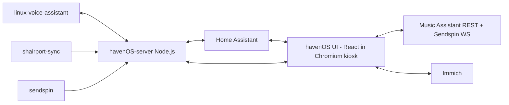

<p align="center">
  
</p>

<h1 align="center">havenOS</h1>

<p align="center">
  A fully local, touch-first smart display for Raspberry Pi.<br />
  Home Assistant powered. Offline voice ready. Zero cloud required.
</p>

<p align="center">
  <a href="SPEC.md"><strong>Read Full Spec</strong></a>
  ·
  <a href="#installation-plan"><strong>Installation Plan</strong></a>
  ·
  <a href="#roadmap-v01"><strong>Roadmap</strong></a>
</p>

---

## What Is havenOS?

havenOS is a Nest Hub-style ambient display experience, built to run entirely on your local network. It runs in Chromium kiosk mode on a Raspberry Pi touchscreen, uses Home Assistant as a data/control bus, and renders a fully custom interface designed for glanceability and touch.

## Project Status

| Item | Value |
|------|-------|
| Version | 0.1 (draft) |
| State | Pre-development |
| Source of truth | [SPEC.md](SPEC.md) |
| Current repo contents | Specification-first docs |

## Why This Exists

- Local-first by design: no cloud APIs, no cloud dependencies
- Touch-first UX: large hit targets and appliance-style interactions
- Ambient-first display: useful from across the room at a glance
- Custom UI, not Lovelace for primary flows
- Reliable, deterministic install target for Raspberry Pi OS Lite

## Installation Plan

Implementation is intentionally spec-first right now and should follow [SPEC.md](SPEC.md).

Installer goals:

- One-command setup for Raspberry Pi OS Lite
- Deterministic package and runtime bootstrap
- Safe re-runs (idempotent behavior)
- Local configuration bootstrap with clear post-install instructions

## System At A Glance



Runtime processes:

1. havenOS-server (Node.js)
2. havenOS-ui (Chromium kiosk)
3. linux-voice-assistant
4. shairport-sync
5. sendspin

## Planned Experience

Primary app states:

1. ambient
2. active
3. listening
4. detail
5. ha_dashboard

Key feature set:

- Ambient photo slideshow with large clock and weather
- Active dashboard with module cards and quick controls
- Offline voice listening, processing, and response states
- Full-screen detail overlays for core modules
- Embedded Home Assistant dashboard escape hatch
- Local broadcast announcements (visual + optional TTS)
- Cast/audio source support via shairport-sync and sendspin-cli

## Hardware Target

- Raspberry Pi 4 (4GB+)
- 7"-10" HDMI touchscreen
- Target layout: 1280x800 (graceful fallback to 1024x600)
- ReSpeaker 2/4-mic input hardware
- USB DAC or 3.5mm audio output path
- Raspberry Pi OS Lite 64-bit

## Planned Tech Stack

- Frontend: React 18, Tailwind CSS v4, Framer Motion
- State: Zustand
- Data layer: TanStack Query
- WebSockets: react-use-websocket
- Build: Vite + TypeScript (strict)
- Backend: Node.js
- Runtime browser: Chromium kiosk mode

## Integrations

### Home Assistant

- HA WebSocket API + long-lived token
- Entity subscriptions and service calls
- havenOS entities (planned):
  - media_player.havenos_display
  - notify.havenos_display
  - number.havenos_brightness
  - switch.havenos_screen
  - sensor.havenos_screen_state
  - sensor.havenos_voice_state
  - switch.havenos_wake_word
  - button.havenos_next_photo
  - sensor.havenos_current_photo
  - sensor.havenos_active_source

### Voice

- linux-voice-assistant over local ESPHome protocol
- Phase updates sourced from localhost:6053

### Photos

- Immich on local network
- Fallback to dark ambient background if unavailable

### Music

- Music Assistant REST for browse/queue
- Sendspin WebSocket roles for realtime metadata/control
- AirPlay via shairport-sync

## Planned Local API Surface

havenOS-server local endpoints on http://localhost:3000:

- GET /api/config
- POST /api/config
- POST /api/brightness
- POST /api/broadcast
- POST /api/wake-word
- WS /events

Broadcast payload example:

```json
{
  "message": "Front door opened",
  "title": "Security",
  "icon": "door",
  "tts": true
}
```

## Roadmap (v0.1)

In scope:

- Core dashboard and ambient experience
- Local voice workflow UI
- Weather, music, timers, and controls module framework

Out of scope:

- Video playback services
- Video calls
- Automatic smart device onboarding
- Multi-user profiles
- Cloud integrations
- OTA update system
- Multi-display orchestration

## Open Questions

- linux-voice-assistant phase schema over ESPHome API
- Timer naming/intents mapping in HA Assist
- On-screen keyboard strategy for touch text entry
- HDMI touchscreen brightness compatibility coverage
- Immich version compatibility policy

## Canonical Specification

For complete behavior, module details, UI states, transitions, and constraints, read [SPEC.md](SPEC.md).